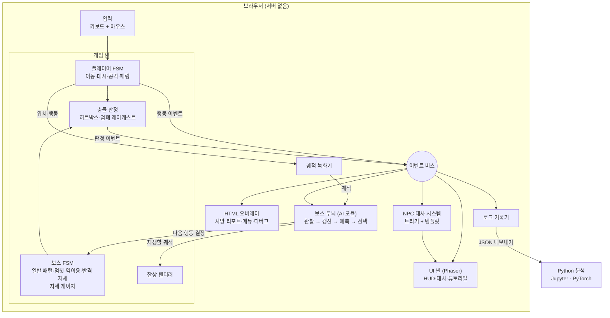

# READ ME (가칭) — 프로젝트 계획서

> **"튜토리얼이 가르친 정석을, 보스가 학습해서 역이용한다."**
> 플레이어의 습관을 학습해 공략해 오는 보스와 싸우는 탑다운 2D 소울라이크 브라우저 게임

| 항목 | 내용 |
|---|---|
| 문서 버전 | v0.2 |
| 작성일 | 2026-11-07 |
| 상태 | 검토 중 |
| 성격 | 개인 취미 프로젝트 (AI 도구 활용 개발 기록 겸 포트폴리오) |

### 설계 문서

| 문서 | 내용 |
|---|---|
| [전투 시스템](design/combat-system.md) | 조작, 자세 게이지, 빈틈, 일반 패턴, 적응 3단계, 난이도·공정성 원칙 |
| [보스 패턴](design/boss-patterns.md) | 잔상 시스템, 역이용 예고 설계, 패턴 카드, 후보 목록 |
| [스토리](design/story.md) | 세계관(가상 전투 시뮬레이션 베타 테스트), 헬퍼, 막 구성, 거역의 전환점, 반전·떡밥 |
| [내러티브](design/narrative.md) | 3막 구조, 헬퍼, 대사 원칙, 사망 리포트, 측정 |
| [학습 연출·사망 시스템](design/learning-feedback.md) | 학습을 보여주는 14가지 방법, 한 방 사망, 빠른 부활, 5단계 체크포인트, 사망 지도, 헬퍼 안내와 강제 사망 연출 |

---

## 목차

1. [프로젝트 개요](#1-프로젝트-개요)
2. [게임 디자인 요약](#2-게임-디자인-요약)
3. [AI 설계](#3-ai-설계)
4. [기술 스택](#4-기술-스택)
5. [시스템 구조](#5-시스템-구조)
6. [마일스톤](#6-마일스톤)
7. [작업 프로토콜](#7-작업-프로토콜)
8. [문서 체계](#8-문서-체계)
9. [위험 요소와 대응](#9-위험-요소와-대응)
10. [참고 자료](#10-참고-자료)

---

## 1. 프로젝트 개요

### 1.1 한 줄 소개

튜토리얼에서 "빈틈이 보이면 공격"을 가르친 보스가, 플레이어가 그 빈틈에서 늘 몇 번 때리는지 학습한 뒤 마지막 타를 패링해 온다. "…이런 식으로 막던가?"

### 1.2 목표

| 구분 | 목표 |
|---|---|
| 게임 | "보스가 나를 읽고 있다"는 감각이 실제로 느껴지는, 어렵지만 공략 가능한 보스전 1개 |
| 기술 | 학습 알고리즘(빈도 모델 → 밴딧 → 궤적 분석 → 신경망 → 파인튜닝)을 직접 구현하고 데이터로 검증 |
| 과정 | AI 코딩 도구로 개발하면서 그 과정(잘한 점, 못한 점, 통제 방법)을 체계적으로 기록 |

### 1.3 범위

| 하는 것 ✅ | 하지 않는 것 ❌ |
|---|---|
| 보스 1마리, 경기장 1개 (3막 + 탄막 페이즈) | 여러 스테이지, 던전 탐험 |
| 무기 1종 | 무기 다양화, 업그레이드 트리 |
| 브라우저 실행, 서버 없음 | 서버, 계정, 멀티플레이 |
| 로컬에서 동작하는 학습 AI | LLM API 호출 (비용 0원 원칙) |
| 도형 기반 미니멀 그래픽 | 3D, 고품질 픽셀 아트 |

### 1.4 개발 방식

- **AI 주도 개발**: 코드는 AI 코딩 도구가 주로 작성하고, 개발자는 방향 결정·검증·기록을 맡는다.
- **이해는 후순위**: 취미 프로젝트이므로 모든 코드를 즉시 이해하는 것을 목표로 하지 않는다. 대신 이해하지 못한 부분을 [이해 부채 목록](#84-이해-부채-목록)에 쌓아 두고 나중에 정리한다.
- **작게 만들고 → 해보고 → 고치기**를 반복한다. 실패도 정식 기록으로 남긴다.

---

## 2. 게임 디자인 요약

> 상세는 [설계 문서](#설계-문서) 참고. 이 장은 핵심 결정만 요약한다.

### 2.1 주제와 구조

> **"가르쳐 놓고, 빼앗는다."** — 예고도, 가이드도, 플레이어의 기술도 같은 원리로 하나씩 사라진다.

| 막 | 이름 | 핵심 |
|---|---|---|
| 1막 | 가르침 | 정직한 보스 + 가이드 NPC가 정석을 가르침 |
| 2막 | 관찰 | 보스가 멈칫하고, 잔상이 등장하고, NPC도 배신당함 |
| 3막 | 역이용 | 예고 축소, 탄막 페이즈, 방패 탈취 |
| 최종 | 거울 | 보스가 내 방식으로 싸움 |

### 2.2 시점과 비주얼

| 항목 | 결정 |
|---|---|
| 시점 | 2D 탑다운 (비스듬히 내려다보는 느낌은 2.5D 기법으로) |
| 2.5D 기법 | Y 정렬, 발밑 그림자, 높이(z) 값 분리, 히트스톱·화면 흔들림 |
| 그래픽 | 흰 배경 + 검은 선/도형 |
| 색 | **빨강** = 위험(공격 예고·범위) / **회색 반투명 + 점선 외곽** = 잔상 |
| 예고 표현 | 공격 범위를 점선으로 → 실선으로 바뀌는 순간 판정 |
| 전투 감각 참고 | 「세피리아」의 대시·패링·공격 범위 표시·동작 고정 (무기 다양화·인벤토리·로그라이트는 제외) |

### 2.3 전투

| 항목 | 결정 |
|---|---|
| 조작 | WASD 이동 / 마우스 조준 / 좌클릭 공격(최대 3타, 3타 = 한 바퀴 베기) / 대시 + 좌클릭 대시 찌르기 / 우클릭 패링 / Space 대시 |
| 자원 | 스태미나, 재시도(구간당 5). **모든 공격 한 방 사망 → 직전 패턴 전으로 빠른 부활** ([학습 연출 §5](design/learning-feedback.md#5-사망-시스템)) |
| **자세 게이지** | 보스에게 있음. 패링 성공(크게)·공격 적중(조금)으로 증가, 쉬면 회복, 가득 차면 자세 붕괴 → 큰 빈틈 |
| 빈틈 | 패턴 후 경직, 헛손질 응징, 연타 사이, 준비 동작 끊기, 등 뒤, 자세 붕괴, 헛짚음 |
| 일반 패턴 | 일반 공격 6~8개 (분기·지연 포함). 예고·판정은 **고정** |
| 적응 3단계 | 고정 / 미세 적응(보이지 않게, 사망 리포트에서 공개) / 가시적 변칙 |
| 난이도 | 어렵지만 공정하게. 목표 평균 5~10회 도전에 클리어 `[추정]` |

### 2.4 학습 패턴

| 패턴 | 학습 | 마일스톤 |
|---|---|---|
| **세 번째 칼날** | 빈틈에서의 콤보 길이 → 마지막 타 패링 | M1 |
| **중앙 내려찍기** | 회피 궤적 → 잔상이 가는 곳 공격 | M1 |
| 암반 엄폐 | 엄폐 각도, 나오는 방향 | M2 |
| 탄막 페이즈 | 위치 히트맵, 궤적 | M2~M3 |
| 방패 탈취 → 거울 | 패링 의존도·타이밍 → 보스가 내 패링을 사용 | M2 |

### 2.5 학습을 느끼게 하는 장치

| 장치 | 내용 |
|---|---|
| 멈칫 + 시선 | "지금 너를 읽었다" (전용 색 예고는 쓰지 않음) |
| **잔상** | 녹화된 **내 실제 과거 궤적**을 재생 → 보스가 그 도착 지점을 공격. 학습의 증거이자 예고 |
| 구체적 대사 | "세 번째. 늘 세 번째였지." (회차·수치 포함) |
| 가이드 NPC | 함께 배신당하고, 새 규칙을 함께 발견 |
| 사망 리포트 | 보스가 알아낸 것 + 예측 vs 실제 재생 + 미세 적응 공개 |
| 거울 페이즈 | 보스가 내 방식으로 싸움 |

### 2.6 공정성 원칙 (요약)

선택지가 있어야 학습이다 · 예고는 진실이어야 한다 · 항상 해결책이 남는다 · 읽힌 쪽에도 기회가 있다 · 확률 상한 · 망각 · 한 사건에 벌은 하나 · 방어 수단을 동시에 다 빼앗지 않는다 · 첫 학습 순간은 죽지 않는다 · 역이용당할 수 있는 보스

→ 상세: [전투 시스템 §8](design/combat-system.md#8-공정성-원칙)

---

## 3. AI 설계

### 3.1 "이 보스는 AI인가?" — 용어 정의

| 구성 | 하는 일 | 분류 |
|---|---|---|
| 예측 | 플레이어의 다음 행동·궤적을 데이터로 추정 | 통계적 머신러닝 (경험이 쌓일수록 예측 성능이 오름) |
| 대응 | 예측을 보고 어떤 공격을 쓸지 선택 | 변칙 패턴: 규칙 기반 / 일반 공격 선택: 밴딧(강화학습) |

정확한 표현: **"온라인 확률 모델과 궤적 기록으로 플레이어를 예측하고, 규칙 기반 + 밴딧으로 대응하는 보스"**

- "딥러닝 보스"라고 부르지 않는다 (신경망은 M4 이후, 그것도 소형 모델).
- 빈도 모델의 숫자는 신경망 "가중치"가 아니라 "횟수·확률"이라고 부른다.

### 3.2 AI 기법과 쓰임새

| 기법 | 쓰임새 | 마일스톤 |
|---|---|---|
| 빈도 세기 + 망각 | 콤보 길이, 회피 방향, 패링 타이밍 분포 | M1 |
| 궤적 녹화·재생 | 잔상 (최근 궤적) | M1 |
| 2차원 빈도 (히트맵) | 탄막 위치 습관 | M2 |
| n-gram + 백오프 | 행동 순서 패턴, 처음 보는 상황 대응 | M3 |
| 멀티암드 밴딧 | 일반 공격 선택 미세 적응 (가중치 0.8~1.3배 제한) | M3 |
| 대표 궤적 (medoid) | 잔상 = "평소의 나" | M3 |
| 궤적 클러스터링 (DTW 검토) | 습관 유형 발견 | M4 |
| 소형 신경망 (MLP) vs 베이스라인 | 여러 상황 정보를 합친 예측, 비교 실험 | M4 |
| 파인튜닝 | 일반 플레이어 모델 → 특정 플레이어 맞춤 | M5 |
| 시퀀스 예측 모델 (도전) | 다음 궤적 생성 | M5 |

### 3.3 백오프 구조 (M3)

```
1순위: 최근 행동 2개 기준 예측   → 기록 없으면
2순위: 최근 행동 1개 기준 예측   → 기록 없으면
3순위: 전체 빈도                 → 기록 없으면
4순위: 튜토리얼 정석 (기본값)     ← 게임 시작 직후
```

> 데이터가 없을 땐 "튜토리얼대로 행동하는 평범한 보스", 데이터가 쌓이면 "나를 아는 보스". 기술 구조와 3막 구성이 같은 흐름이다.

### 3.4 M4~M5 실험 설계 (Python)

```
1. 플레이 로그·궤적 수집 (직접 플레이 + 지인 + 스타일별 봇)
2. 베이스라인(빈도 모델)과 신경망의 예측 정확도 비교
3. 파인튜닝 비교:
   (a) 일반 모델 그대로
   (b) 해당 플레이어 데이터로만 처음부터 학습
   (c) 일반 모델 + 파인튜닝
4. 신경망이 실제로 더 나을 때만 게임에 도입 (ONNX로 변환해 브라우저에서 실행)
```

- 데이터가 적은 환경에서는 신경망이 베이스라인보다 나쁠 수 있다. 그 결과도 기록한다.
- 봇이 생성한 합성 데이터는 실제 사람과 다를 수 있다는 한계를 명시한다.

### 3.5 학습 검증

"학습한다"를 느낌이 아니라 테스트로 증명한다.

```
테스트: 빈틈마다 항상 3타까지 치는 봇 × 10판
기대:   판이 지날수록 보스의 3타 패링 시도 비율 증가 (상한 이내)
확인:   자동 테스트(Vitest) + 로그 그래프(Python)
```

---

## 4. 기술 스택

### 4.1 선택한 스택

| 층 | 기술 | 역할 | 선택 이유 |
|---|---|---|---|
| 언어 | TypeScript | 게임 전체 | 브라우저 실행, 타입 문법이 Java와 유사 |
| 게임 프레임워크 | Phaser | 게임 루프·입력·렌더링·씬 관리 | 2D 웹 게임용으로 성숙, 자료 풍부 |
| 빌드 | Vite | TS → JS 변환·번들, 개발 서버 | 설정이 단순, 저장 즉시 반영 |
| 게임 로직 구조 | 유한 상태 머신(FSM) | 플레이어·보스 상태 관리 | 규칙을 명확하게 표현 |
| AI 모듈 | 순수 TypeScript (라이브러리 없음) | 빈도·궤적·밴딧 | 원리를 코드로 직접 구현, 게임과 분리 |
| 테스트 | Vitest | AI 모듈 등 로직 검증 | Vite와 같은 생태계 |
| 코드 품질 | ESLint + Prettier | 스타일 통일, 실수 경고 | |
| 에디터 | VS Code | 개발 환경 | |
| 버전 관리 | Git + GitHub | 코드·문서 이력 | |
| 배포 | GitHub Pages + GitHub Actions | 푸시하면 자동 빌드·공개 | 무료, 링크 하나로 플레이 가능 |
| 분석·ML | Python, pandas, Jupyter, PyTorch | 로그 분석, M4~M5 실험 | 기존 역량 활용 |
| (선택) 브라우저 ML | ONNX Runtime Web / TensorFlow.js | 학습된 모델을 브라우저에서 실행·학습 | M4~M5 도입 시 |

### 4.2 검토한 대안

| 대안 | 제외 이유 |
|---|---|
| Python + Pygame | 웹 배포가 번거로움 |
| Godot | 엔진 학습 부담, 코드 흐름이 에디터 설정에 분산 |
| 3D (Three.js 등) | 모델·카메라·3D 충돌 부담이 커서 핵심(AI)에 도달하기 어려움 |
| 아이소메트릭 | 좌표 변환·겹침 정렬이 까다로움. 2.5D 기법으로 대체 |
| LLM API 활용 | 실시간 판단에 응답이 너무 느리고, 비용 발생. 대사도 템플릿으로 충분 |

### 4.3 비용

| 항목 | 비용 |
|---|---|
| 개발 도구·라이브러리·배포 | 0원 (오픈소스, GitHub 무료 기능) |
| LLM API | 0원 (사용하지 않음) |
| 신경망 학습 | 0원 (소형 모델, 로컬 CPU 예상) |
| AI 코딩 도구 | 기존 사용 중인 요금제 외 추가 없음 |

---

## 5. 시스템 구조

### 5.1 아키텍처



### 5.2 설계 원칙

| 원칙 | 내용 | 효과 |
|---|---|---|
| AI 모듈 분리 | 보스 두뇌는 Phaser를 모른다. 이벤트·궤적을 받고 결정만 돌려준다 | 테스트 쉬움, 모델 교체 쉬움 |
| UI 분리 | 게임 로직은 UI를 모른다. 이벤트만 발행한다 | UI를 바꿔도 로직은 그대로 |
| 이벤트 중심 | 게임 → 이벤트 버스 → (AI, NPC, UI, 로그) | 데이터 흐름이 한눈에 보임 |
| UI 이원화 | 매 프레임 갱신 UI는 캔버스, 표·버튼 중심 UI는 HTML/CSS | 성능과 개발 편의 모두 확보 |
| 데이터 주도 | 대사·패턴 수치는 코드가 아닌 데이터(JSON)로 | 수치 조정과 대사 추가가 쉬움 |

### 5.3 보스 두뇌 파이프라인

```
플레이어 행동·궤적 → 기록 → 통계 갱신(망각 포함) → 예측 → 대응 선택(확률 상한 적용) → 보스 FSM / 잔상
```

---

## 6. 마일스톤

> 기간은 하루 2~3시간 작업 기준의 **추정치**이며, AI 주도 개발로 단축될 수 있다. 실제 소요 시간은 devlog에 기록해 예상과 비교한다.

| 단계 | 목표 | 완료 기준 | 예상 |
|---|---|---|---|
| **M0 준비** | 개발 환경과 저장소 | 저장소 생성, Vite + Phaser + TS 실행, 빈 화면이 GitHub Pages에 자동 배포됨 | ~1주 |
| **M1 재미 검증** | "보스가 나를 읽는다"는 느낌이 드는지 확인 | 아래 M1 범위 구현 / 본인 + 지인 2~3명 플레이 후 [측정 질문](design/narrative.md#7-측정-m1-재미-검증) 기록 | 2~3주 |
| **M2 게임 완성** | 처음부터 끝까지 플레이 가능한 버전 | 3막 구조, 일반 공격 6~8개, 암반 엄폐, 히트맵 탄막, 방패 탈취 → 거울, NPC 막별 대사, 타격감, 메뉴, 공개 배포 | 3~4주 |
| **M3 AI 고도화** | 예측·대응 모두 학습 | n-gram + 백오프, 일반 공격 밴딧, 대표 궤적, 잔상 탄막 + 스펠 이름, 학습 검증 자동 테스트 통과 | 2~3주 |
| **M4 분석·신경망** | 습관 유형 발견, 신경망이 베이스라인보다 나은지 판단 | 로그 수집 파이프라인, 궤적 클러스터링, 비교 리포트(그래프 포함) | 1~2주 |
| **M5 파인튜닝** | 데이터가 적을 때 파인튜닝 효과 검증 | (a)(b)(c) 비교 리포트, (도전) 시퀀스 예측·브라우저 적용 | 1~2주 |

### 6.1 M1 범위

| 분류 | 내용 |
|---|---|
| 플레이어 | 이동, 대시, 공격(3타 콤보), 패링, 스태미나 |
| 보스 | 일반 공격 3~4개, 자세 게이지, 쉬는 동작(빈틈) |
| 학습 패턴 | **세 번째 칼날** (2막 형태), **중앙 내려찍기 + 잔상** (최근 궤적) |
| 가시화 | 멈칫·시선, 구체적 대사, 가이드 NPC 기본 대사(가르침 → 첫 배신) |
| UI | HUD, 사망 리포트(기본), 디버그 패널(학습 수치 실시간 표시) |
| 그래픽 | 도형만 |

**M1 진행 순서 (11-07 갱신)**

| 단계 | 내용 | 상태 |
|---|---|---|
| 1 | 플레이어 (이동·대시·3타·패링·포션·스태미나) | ✅ |
| 2a | 보스 일반 패턴 4개, 관찰 상태 | ✅ |
| 2b | 전투 판정, 자세 게이지, 결과 화면 | ✅ |
| 2c-1 | 패턴 카테고리, 스태미나 조정, 보스 몸·무기, 조준 추적, 돌진, 연속 베기 | ✅ |
| 조정 1 | 평타 스태미나 절반, 3타 한 바퀴 베기, 대시 찌르기, 대시 98, 보스 예고 ×1.25, 자세 게이지 4초 | ✅ |
| 무기 1부 | 보스 무기 교체(대검·창·해머·쌍검), 쌍검 7연타 | ✅ |
| 조정 2 | 무기별 이동 속도, 범위 +20%, 쌍검 4번 베기 + 돌진 | ✅ |
| 2d | 사망 시스템 (한 방 사망, 체크포인트, 사망 기록·지도) | ✅ |
| 조정 3 | 창 3연속 찌르기, 빠른 부활(되감기 5회), 헬퍼 브리핑, 보호막·미확인 제거 | ✅ |
| 무기 2부 | 총·맨손, 날아가는 물체(탄·충격파), 새 패턴 6개 → 일반 5 / 강 6 | ✅ |
| 2c-3 | 효과음, 바닥 예고 축소 | |
| 3D 시험판 | 2D/3D 결정 | |
| 이후 | 학습 패턴, 헬퍼 대사, 페이즈 기믹 | |

- **M2까지만 해도 독립된 완성작**이다. M3~M5는 확장이며, 어디서 멈춰도 결과물이 남는다.
- **M1 이후 판단 지점**: 학습이 느껴지지 않으면 방향을 수정하고, 그 과정을 실패 기록으로 남긴다.
- **범위 관리**: 새 패턴 아이디어는 [후보 목록](design/boss-patterns.md#5-후보-패턴-목록)에 추가만 하고, 현재 마일스톤 범위는 바꾸지 않는다.

### 6.2 (선택) 실험: 하루 버전 vs 본 버전

M1 전에 AI에게 거의 맡겨 하루 만에 버리는 프로토타입을 만들어, 재미를 빠르게 확인하고 본 버전과 속도·품질·버그를 비교한다. 진행 여부는 M0 완료 시점에 결정한다.

---

## 7. 작업 프로토콜

### 7.1 작업 전 확인 절차

| 작업 크기 | 절차 |
|---|---|
| 큰 작업 (새 기능, 구조 변경, 기술 결정) | ① 요청 정리 → ② 범위 (할 것/안 할 것/바뀌는 파일) → ③ 산출물과 검증 방법 → ④ 확실한 것/추정 구분 → ⑤ **승인 후 실행** → ⑥ 실행 → 검증 → 기록 |
| 작은 작업 (버그 수정, 수치 조정) | 한두 줄 요약 → 확인 → 실행 |

### 7.2 환각 방지 규칙

| 규칙 | 내용 |
|---|---|
| 신뢰도 표시 | `[검증됨]` 실행으로 확인 / `[공식문서]` 출처 링크 있음 / `[추정]` 확인 필요 |
| 버전 기준 | 라이브러리 API는 기억이 아니라 **설치된 버전 + 공식 문서** 기준 |
| 실행으로 증명 | "될 것이다"로 끝내지 않고 실행·테스트 결과로 확인 |
| 이해 못 한 코드 | 커밋은 허용하되 [이해 부채 목록](#84-이해-부채-목록)에 반드시 기록 |

> 환각을 완전히 없앨 수는 없다. 목표는 **틀렸을 때 바로 드러나는 구조**를 만드는 것이다.

### 7.3 AI 사용 기록

큰 작업마다 devlog에 다음을 남긴다.

| 항목 | 내용 |
|---|---|
| 요청 | AI에게 무엇을 요청했나 (프롬프트 요지) |
| 결과 | 그대로 사용 / 수정 / 폐기 + 이유 |
| 문제 | AI 코드로 생긴 버그·오해 |
| 시간 | 예상 소요 vs 실제 소요 |

이 기록을 모아 `docs/ai-vs-manual.md`에 "AI가 잘한 영역 / 못한 영역 / 통제 방법"으로 정리한다.

### 7.4 Git 규칙

| 항목 | 규칙 |
|---|---|
| 브랜치 | `main`(배포) / 작업은 `feat/…`, `fix/…`, `docs/…` 브랜치 |
| 커밋 메시지 | `feat: 대시 무적 시간 추가` 형식 (feat, fix, docs, refactor, test, chore) |
| 병합 | 기능 단위로 main에 병합, 병합 시 자동 배포 |

---

## 8. 문서 체계

### 8.1 저장소 구조

```
read-me-game/
├─ README.md                 # 소개, 플레이 링크, 실행법, 데모 GIF
├─ docs/
│  ├─ 00_project-plan.md     # 이 문서
│  ├─ design/                # 게임 설계 문서
│  │  ├─ combat-system.md
│  │  ├─ boss-patterns.md
│  │  └─ narrative.md
│  ├─ adr/                   # 되돌리기 어려운 큰 결정만 짧게
│  ├─ devlog/                # 날짜별 개발 일지 (중심 문서)
│  ├─ tech-notes/            # 기술 원리 노트 (필요할 때)
│  ├─ understanding-debt.md  # 이해 부채 목록
│  └─ ai-vs-manual.md        # AI 도구 활용 분석
├─ src/
│  ├─ main.ts                # 진입점
│  ├─ scenes/                # GameScene, UIScene
│  ├─ entities/              # Player, Boss (FSM)
│  ├─ brain/                 # 보스 AI 모듈 (Phaser 의존 없음)
│  ├─ recorder/              # 궤적 녹화
│  ├─ events/                # 이벤트 버스, 이벤트 타입 정의
│  ├─ dialogue/              # NPC·보스 대사 시스템
│  ├─ data/                  # 패턴 수치, 대사 JSON
│  └─ ui/                    # HTML 오버레이
├─ tests/                    # Vitest
├─ analysis/                 # Python 노트북, 로그 데이터
└─ .github/workflows/        # 자동 배포
```

### 8.2 devlog 템플릿

```markdown
## YYYY-MM-DD — 작업 제목
- 목표:
- AI 사용: (요청 요지) → 사용 / 수정 / 폐기 + 이유
- 원리 메모: (선택)
- 실패 / 배운 점:
- 소요 시간: 예상 _h / 실제 _h
```

### 8.3 기술 노트 후보

| 주제 | 내용 |
|---|---|
| 이 보스는 AI인가? | AI·ML의 정의와 이 프로젝트의 정확한 분류 |
| n-gram과 백오프 | 처음 보는 상황에 대응하는 방법 |
| n-gram vs 신경망 | 세기와 일반화의 차이 |
| 밴딧 | 가장 단순한 강화학습, 범위 제한이 필요한 이유 |
| 잔상 시스템 | 궤적 녹화·상대 좌표 변환·대표 궤적·DTW |
| 파인튜닝 | 사전학습과 파인튜닝, 프롬프트와의 차이 |
| 배치 vs 실시간 파이프라인 | SoBee-Logs(Airflow)와 이 프로젝트 비교 |
| 게임 루프 | 매 프레임 일어나는 일 |

### 8.4 이해 부채 목록

이해하지 못한 채 넘어간 코드를 기록하고, 여유가 생기면 정리한다.

```markdown
| 날짜 | 파일·위치 | 무엇을 모르는가 | 중요도 | 해결 |
|---|---|---|---|---|
| 11-08 | src/entities/Player.ts | 대시 무적 시간 처리 방식 | 높음 | ☐ |
```

중요도 기준: **높음** = AI 모듈·핵심 전투 로직 / **보통** = 일반 게임 로직 / **낮음** = 설정·보일러플레이트

---

## 9. 위험 요소와 대응

| 위험 | 가능성 | 영향 | 대응 |
|---|---|---|---|
| 전투 손맛이 나쁨 | 중 | 높음 | M1에서 조기 검증, 타격감 요소(히트스톱·흔들림) 우선 적용 |
| 학습이 "공격 바리에이션"으로 보임 | 높음 | 높음 | 잔상(실제 궤적), 구체적 대사, 연속값 개인화, NPC 반응, 사망 리포트. M1 측정 질문으로 확인 |
| 보스가 불공평하게 느껴짐 | 중 | 중 | [공정성 원칙](design/combat-system.md#8-공정성-원칙) 10개를 패턴 카드마다 체크 |
| 차례 지키기식 수동적 전투 | 중 | 중 | 자세 게이지, 다양한 빈틈, 탐색 구간 |
| 처음 쓰는 언어(TS)로 AI 코드 품질 판단 불가 | 높음 | 중 | 실행·테스트로 검증, 이해 부채 목록 관리 |
| AI가 옛 버전 API를 사용 (환각) | 중 | 중 | 설치 버전 + 공식 문서 기준 규칙 |
| 범위 확장 (아이디어가 많음) | 높음 | 높음 | 마일스톤 범위 고정, 새 아이디어는 후보 목록으로만 |
| 신경망 단계의 데이터 부족 | 높음 | 낮음 | 봇 데이터 활용 + 한계 명시, 결과가 나빠도 기록 |
| 동기 저하 | 중 | 높음 | 마일스톤마다 플레이 가능한 결과물, M2에서 공개 |

---

## 10. 참고 자료

### 유사 사례 (적응형 적 AI)

| 사례 | 내용 | 출처 |
|---|---|---|
| 메탈기어 솔리드 V | 헤드샷을 자주 쓰면 적이 헬멧 착용 등, 행동 점수 기반 적응 (Revenge System) | [Metal Gear Wiki](https://metalgear.fandom.com/wiki/Revenge_System_(enemy_preparedness)) |
| Hello Neighbor | 플레이어 행동을 분석해 함정 배치, 너무 똑똑해서 난이도를 낮춰야 했음 | [Game Developer](https://gamedeveloper.com/design/designing-a-domestic-hunter-killer-thriller-the-i-hello-neighbor-i-way) |
| Warning Forever | 보스를 생성하는 AI가 플레이어 패턴을 학습해 다음 보스를 설계 (슈팅) | [First Person Scholar](https://firstpersonscholar.com/?p=2982) |
| 소니 특허 (2026) | 플레이어 전투 데이터로 보스 행동을 적응시키는 시스템 (2025.3 출원, 2026.10 공개) | [Dexerto](https://www.dexerto.com/gaming/sony-patents-new-bosses-that-adapt-to-your-moves-and-weapons-in-real-time-3416311/) / [Dot Esports](https://dotesports.com/general/news/sony-ai-adaptive-npc-patent) |

### 전투 참고

| 게임 | 참고 요소 | 출처 |
|---|---|---|
| 세피리아 (TEAM HORAY) | 탑다운 시점, 대시·패링, 공격 범위 표시, 동작 고정 | [KOCCA](https://welcon.kocca.kr/en/directory/content/sephiria--10251) |
| 세키로 | 체간(자세 게이지) 시스템의 발상 | — |
| 동방 프로젝트 | 탄막, 스펠 카드 이름 붙이기 | — |

### 개념

| 개념 | 출처 |
|---|---|
| AI 정의 (에이전트 관점) | Russell & Norvig, *Artificial Intelligence: A Modern Approach* |
| 머신러닝 정의 (T, E, P) | Tom Mitchell, *Machine Learning* (1997) |

---

## 변경 이력

| 버전 | 날짜 | 내용 |
|---|---|---|
| v0.1 | 2026-11-07 | 초안 작성 |
| v0.2 | 2026-11-07 | 설계 문서 3종 분리. 파란 예고 제거 → 멈칫·시선·잔상. 자세 게이지 추가. 학습 패턴(세 번째 칼날, 중앙 내려찍기, 암반 엄폐, 탄막, 방패 탈취 → 거울) 반영. AI 기법표에 궤적·히트맵·밴딧 쓰임새 추가. M1 범위 구체화, M2~M3 기간 조정. 아키텍처에 궤적 녹화기·잔상·NPC 대사 시스템 추가 |
